## SolidWorks导出URDF文件步骤

1、确认Solidworks软件版本，根据对应软件版本，在 https://github.com/ros/solidworks_urdf_exporter/releases 下载对应的sw2urdfSetup.exe插件，目前推荐使用的是SolidWorks2018版，所选插件如下图所示

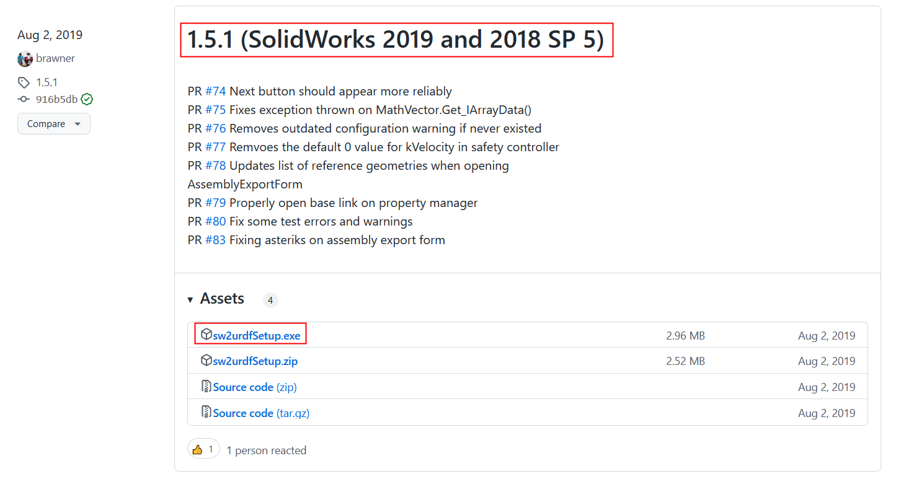

2、安装所下载的sw2urdfSetup.exe，在Solidworks中->选项->插件中显示SW2URDF表示安装成功

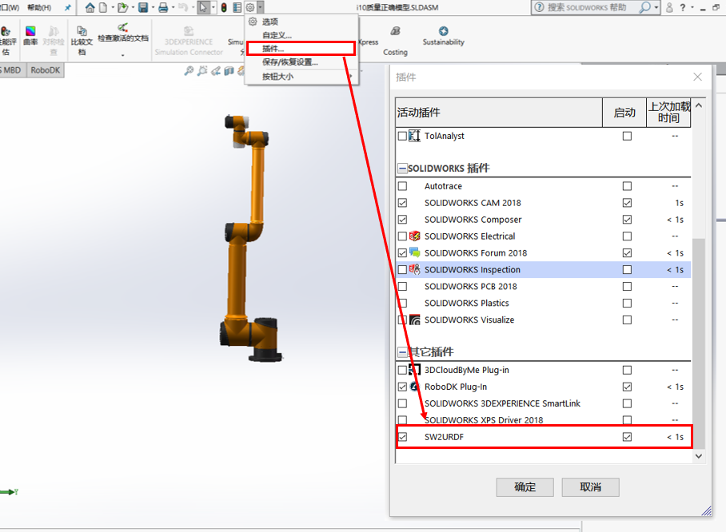

3、导入机械臂三维模型，模型中共存在7个连杆，命名分别为base_link、shoulder_Link、upperArm_Link、foreArm_Link、wrist1_Link、wrist2_Link、wrist3_Link，分别对应显示模型中的link0~link6.

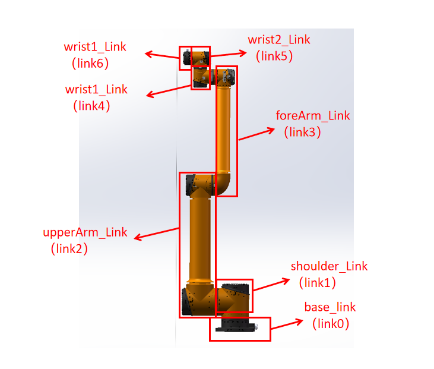

4、建立参考位置点与基准轴

建立草图，在草图中根据各DH坐标系原点的位置，画出相应的7个点；在三关节轴线上、四关节轴线上各画1个点，以保证每个关节轴线上有两个点，用以建立基准轴。

在建立各关节旋转的基准轴时，选用两点建立的方式，根据DH坐标系z轴方向，确定选取点的顺序。以1号坐标系为例，z轴竖直向上，需先选取上面的点，再选取下面的点（选取点的顺序确定轴线方向），这样可以保证导出urdf文件时joint中axis中的值为（0，0，1）而不是（0，0，-1）。

5、在模型中建立参考坐标系，位置（第4步中参考点）、方向（通过前视基准面、上视基准面、后视基准面确认）与DH坐标系相同，如下图所示

6、选择工具->File->Export as URDF

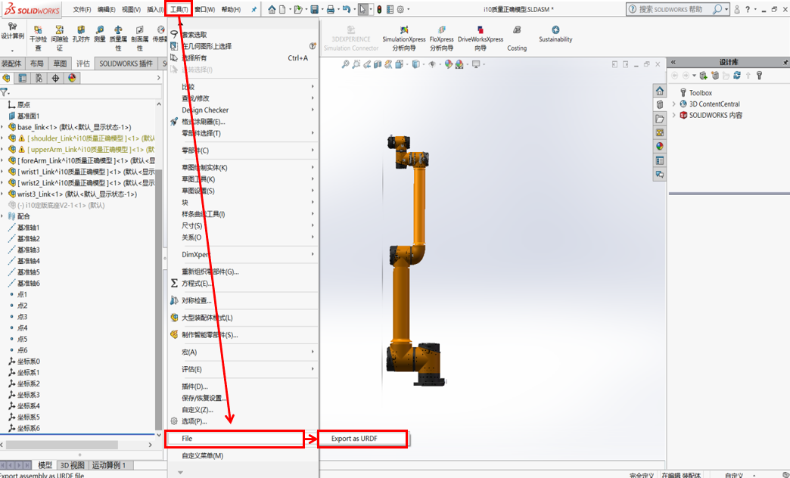

7、填写link名称->选择坐标系->选择该link的组件->该link的子link数，设置好后，选择下面的Empty_Link

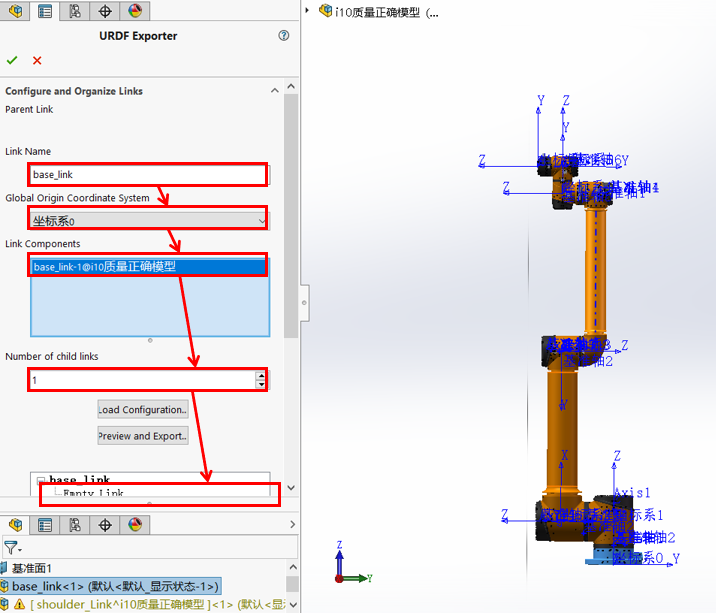

8、更改Empty_Link的相关信息，填写link名称->关节名称->选择参考坐标系->选择参考轴->选择关节类型（revolute）->选择该link的组件->该link的子link数，设置好后，选择下面的Empty_Link，继续填写子连杆信息。

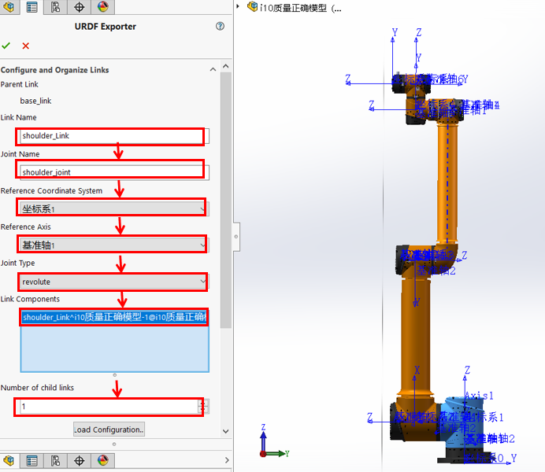

Joint Type：

（1）continuous: 旋转关节，可以绕单轴无限旋转；

（2）fixed: 固定关节，不允许运动的特殊关节；

（3）floating: 浮动关节，允许进行平移、旋转运动；

（4）planer: 平面关节，允许在平面正交方向上平移或旋转；

（5）prismatic: 滑动关节，沿某一轴线移动的关节，有位置极限；

（6）revolute: 旋转关节，类似于 continues,但是有旋转角度限制。

9、编写完各连杆信息后，点击Preview and Export，随后编写关节信息。

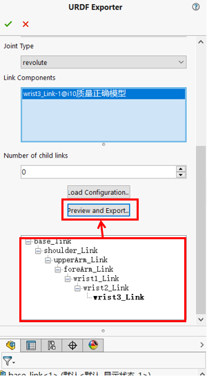

10、Joint信息确认

（1）确认Orientation 中Roll、Pitch、Yaw(rpy)角度是否正确，如shoulder_joint中的ryp角度为坐标系0按照固定rpy角旋转到坐标系1的角度；

（2）目前aubo机械臂各关节均绕DH坐标系z轴正向旋转，所以Axis中信息（x，y，z）应为（0，0，1）；

（3）在Limit中填入关节位置上下限（lower，upper），关节平均负载扭矩（effort），关节速度限制（velocity）；

（4）点击Next进行下一步。

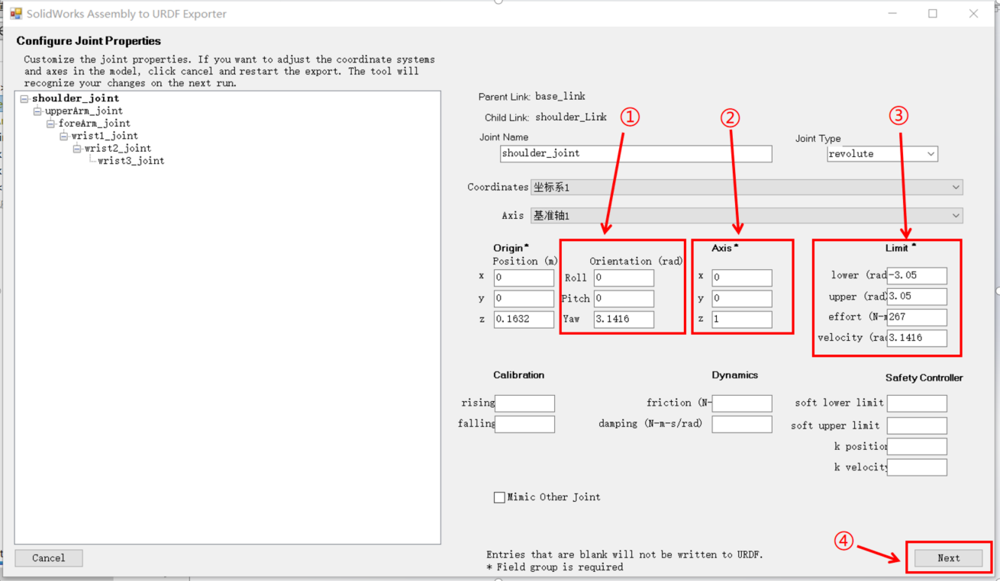

11、Link信息确认

（1）各连杆Inertial 中的质量、质心、惯量值的准确性取决与三维模型的准确性；

（2）aubo机械臂由机械部提供的显示模型和碰撞模型的坐标系与DH坐标系相对应，Visual and Collision Meshes 中的（x，y，z）为（0，0，0），（Roll，Pitch，Yaw）为（0，0，0），不进行偏置；

（3）点击Export URDF Only... 

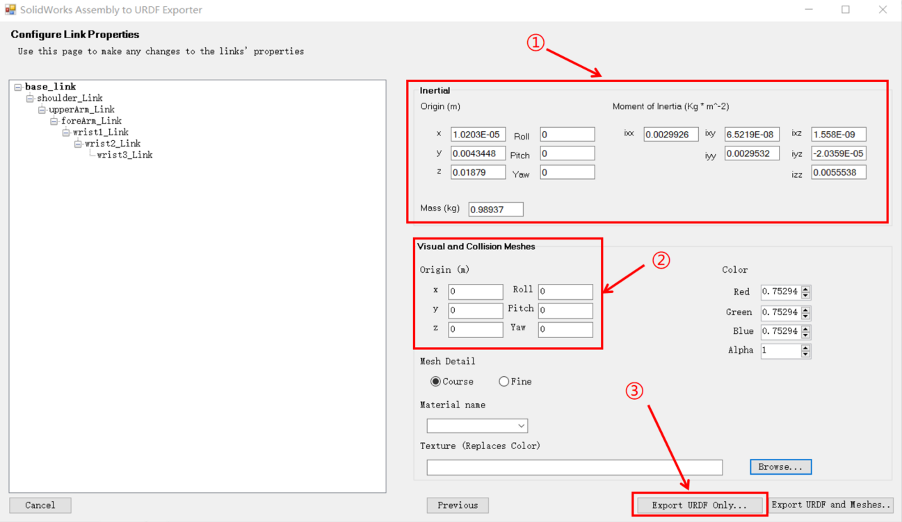

12、选择保存路径，即可生成该机械臂的urdf文件。

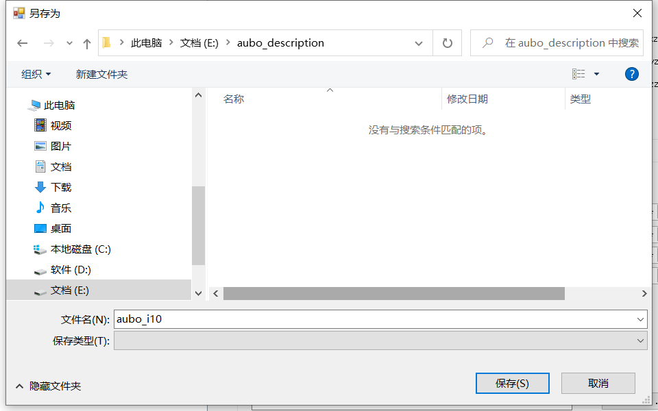

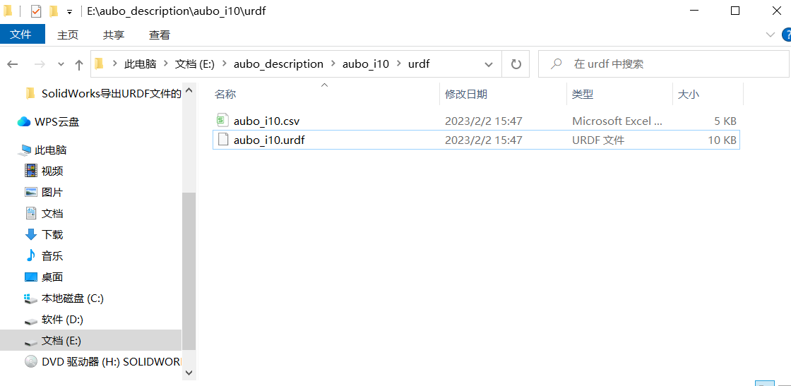

13、打开所生成urdf文件，对比已有的aubo_i5.urdf文件，对所生成的urdf进行更改

（1）添加dh类型，安全参数

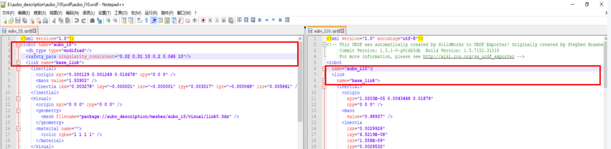

（2）Link信息更改：

更改所有Link的3ds显示模型、STL碰撞模型的地址

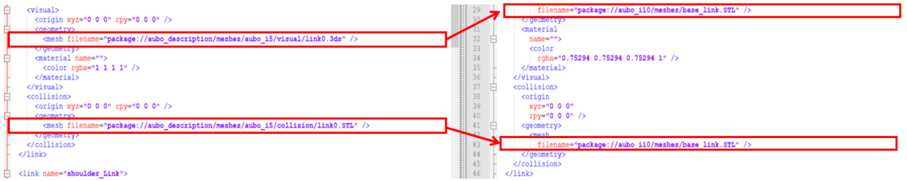

（3）Joint信息更改：

在limit中添加关节起停扭矩信息；

添加property信息，其中包括转子惯量，阻尼，偏置，力矩系数，减速比。

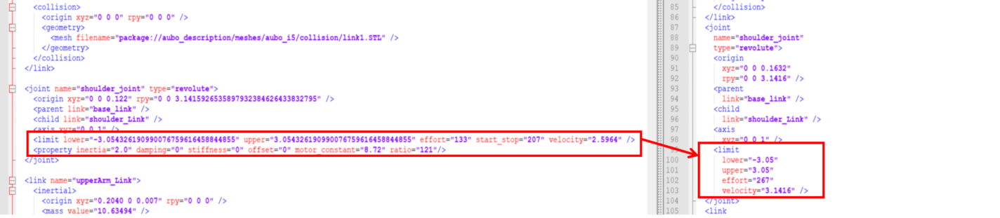

（4）添加世界坐标系信息

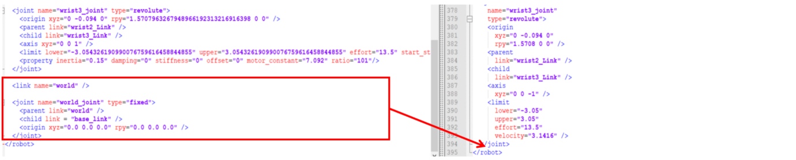

**待解决问题：**

1、第10步joint信息中的rpy角度可能发生错误，如upperArm_joint的rpy角本应是（-pi/2，-pi/2，0），在导出的urdf中却是（pi/2，pi/2，0）；

2、link中动力学参数信息也可能不准确。

