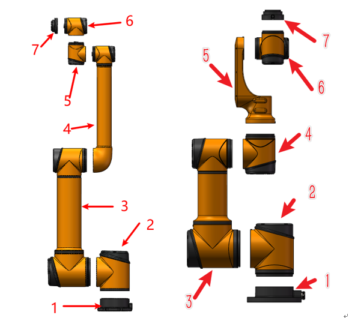
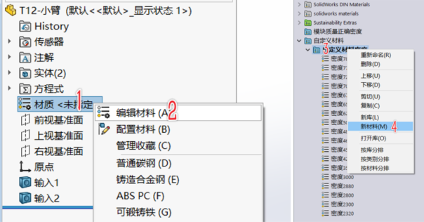
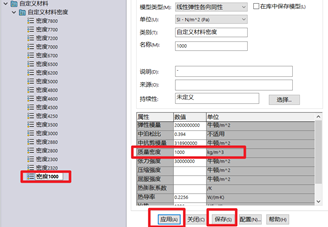
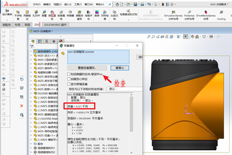
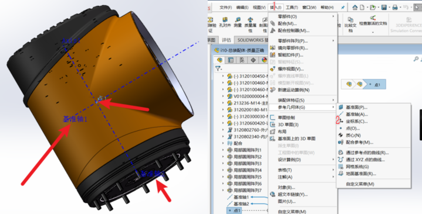
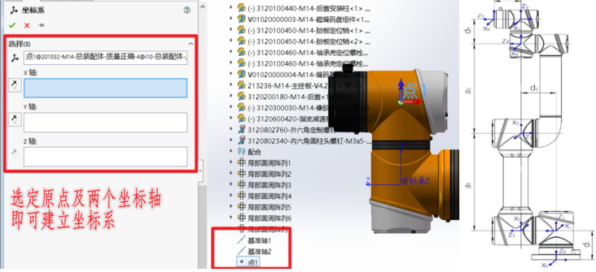
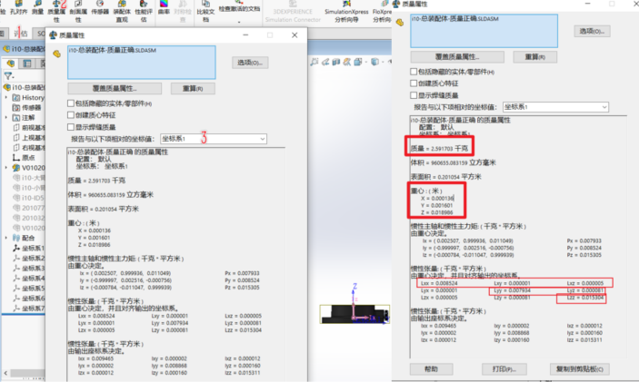
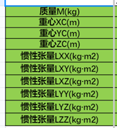

# 动力学理论模型建立

**一、现有模型分解**

1、 目前现有i系列 可以分为如下组成6个关节的7个部分，其他系列6个自由度的机械臂也是同理，6个自由度由7个部分组成。

2、 针对供应商给到的减速机、电机等模型，将不同的部分，比如谐波减速机的波发生器与刚柔轮部分分为两个零件，电机的定子、转子、电机轴等密度不相同的部分也需要单独为零件。 

**二、	称量各零件质量**

1、	实测各成品关节模块、底座装配体质量、大臂及中心引线、小臂及中心引线等部分质量

2、	参照<<模块零部件质量实测数据>>实测模块中各部分零件的质量。

**三、	创建合适的密度，将零件质量与称量质量相符**

1、	找出第二步中测量质量的各零件，采取赋予合适的密度，将零件实际质量与测量质量达到一致。

2、	检查其他未测量的零件是否赋予了材质及是否与给到供图纸一致，因为加工件为相同且明确的材质，一般质量不会有较大出入。

3、	新定义的材料将名称与赋予的密度一致并保存，可后续使用。

4、 检查及赋予各零件材料后，可读取部分组件质量并与称量的组件相校核，反查遗漏。比如电机模组质量、末端法兰装配体质量、整关节模块质量等将制作模型与实际称量对比。此步骤应检查所读取装配体中零件，不可存在缺失及重复，若有隐藏零件，则检查不被包含在内。

**PS：**

1、由于线束的存在，模块称量过程中可能有稍许质量差异，此时可根据线束存在的实际位置，给予部分零件增加些许密度，以将实物与模型质量及质心分布保持一致。

2、螺钉、轴承等标准件也是其中不可或缺的质量组成，在装配体内部的这些标准件模型质量或密度应与实物保持一致。连接各装配体的螺钉等应确认其所属装配体，可参照第一步将整个机械臂做成7个部分的小装配体。其中连接法兰与下一个模块之间的螺钉及法兰应归属于下一个模块（严格来说法兰/钢轮/磁编轴等都归属于下一个模块）。

**四、创建坐标系**

1、 将如上步骤确认的7个质量正确的模块组成机械臂。如果有条件也可以将这7个组件再称量重量，反校核3D模型的质量，如有较大差异须再进行修正。

2、在7个装配体上分别建立原点及基准轴，具体位置及方向参照下图线框图。

**PS：**

1、7个坐标轴建立的元素（原点及两个方向）必须基于装配体上，否则影响后续。

2、坐标系建立后，可根据机械臂DH参数图检查坐标系建立位置是否正确。

3、底座坐标系建立的时候要注意，需要选轴与地面焦点构成远点，不可以直接将地面的中心建立成原点。

**五、读取相关参数制表**

1、因后续操作容易导致装配体在操作中错误保存，建议在此步骤做个备份。

2、分别读取这7个装配体的相关参数，从底座开始，依次将其余6个装配体压缩或删除，相对坐标系应注意与装配体对应。右侧红框中的截图就是需要的数据。

3、按照算法部提供的模板表格，依次填写上述数据。

