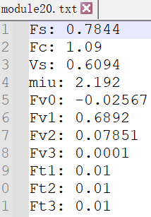
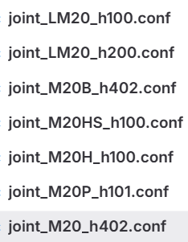
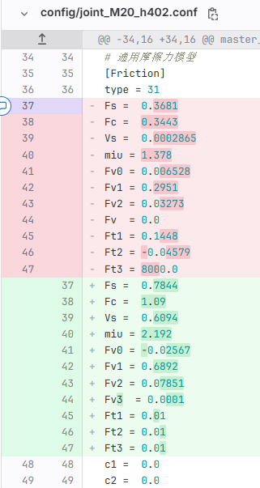

# 如何更新通用摩擦力参数

## 第一步、获取辨识过程数据

1、同一种20关节模块，需要拿到辨识过程数据，从NAS服务器下载辨识过程数据；

登录NAS服务器，必须使用公司网才可以登录，服务器网址：[Aubo-NAS - Synology NAS (rock119.direct.quickconnect.cn)](https://172-17-21-35.rock119.direct.quickconnect.cn:5001/#/signin) 

用户名：auboyf；密码：$Ys1E3a6

2、登录后，点击“File Station”图标，有三台工控机，对应三个MK01、MK02、MK03；

3、选择一台工控机，搜索需要的关节模块，例如：搜索M20，就可以看到关于M20关节模块的所有辨识过程数据；

4、根据需要，点击右键，下载需要的数据即可；

## 第二步、计算通用摩擦力参数

1、算法部同事计算出通用摩擦力参数，例如：20模块通用摩擦力参数如下：

注：通用摩擦力计算原则是宁可难拖动一些，也不愿出现摩擦力估算过大造成飞车的情况；

## 第三步、修改通用摩擦力参数

1、在aubo_description\config目录下，找到同一种20关节模块，同种模块的摩擦力参数都需要修改；

例如：joint_LM20_h100.conf、joint_LM20_h200.conf、joint_M20_h402.conf、joint_M20B_h402.conf、joint_M20H_h100.conf、joint_M20HS_h100.conf、joint_M20P_h101.conf等conf文件都需要修改；

2、修改conf文件中的通用摩擦力模型，关键字“Friction”；

例如：joint_M20_h402.conf文件，找到Friction关键字后，修改Fs Fc Vs miu Fv0 Fv1 Fv2 Fv3 Ft1 Ft2 Ft3的值，c1/c2默认0.0；

