# 导出碰撞模型和渲染模型说明

## 一、概述

- 本文档阐述新型号机械臂产品导入ARCS软件所需碰撞/渲染模型输出的通用方法，机械工程师可参考此文档输出相关模型，并提交到**aubo_description/meshes**中对应仓库
- 涉及人员及职能   
（1）**事业部、产品线或机械部机械工程师**：将产品三维设计图按需转化为碰撞和渲染模型，并输出和提交对应模型，最终确认效果与产品一致     
（2）**算法部 张世亮**：DH参数确认/meshlab模型转化/提交模型     
（3）**软件部 郝帅或娄威**：验证导入效果，确认满足使用要求    
- ***注意：所有导出的碰撞模型和渲染模型，文件名均需统一为小写形式，如link1.stl，link2.3ds等，避免使用大写LINK或Link等***

## 二、准备工作

- 机械臂本体**外观和机械设计阶段性Fix**，如投手板样机阶段或模具品阶段锁定的设计方案

- 确认该型号机械臂**DH参数**，供简化模型在solidworks中建立坐标系参考使用（下图示例为S3 DH参数，并包含DH参数及坐标系确认方法）
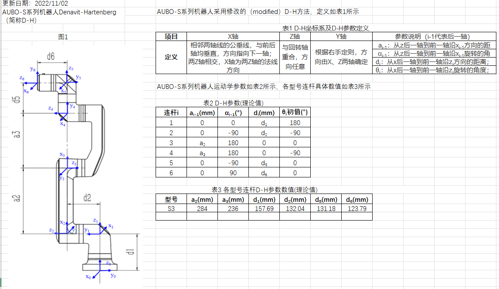   

- **所需软件** 
    - Solidworks（AUBO当前采用2018版本）
    - 3ds Max (本文档以2021版本为例)
    - meshlab（以windows版本为例，win版本可用于检查模型和颜色是否满足要求，linux版本导出的模型才能直接用于ARCS使用）   

- **连杆定义说明**：当前模块到下一模块输出端法兰之间部分为一个连杆,以i系列和S系列为例：   
    - 底座为**link0**
    - 一关节为**link1**
    - 二关节大臂管三关节为**link2**
    - 小臂管四关节为**link3**
    - 五关节为**link4**
    - 六关节为**link5**
    - 末端为**link6**    
    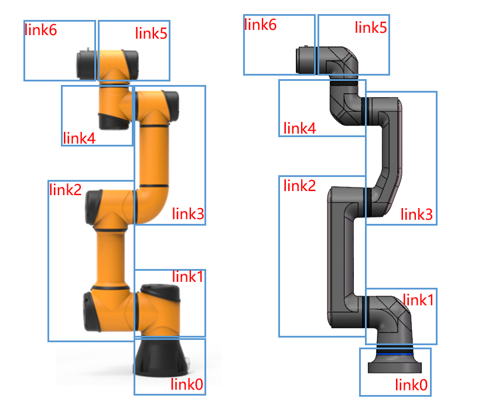

## 三、碰撞模型输出

- 碰撞模型是模拟机械臂运行过程中本体各关节和臂管之间可能发生的真实物理碰撞的简化模型，用于软件算法在进行运动规划和控制时规避本体发生自碰撞
- 在ARCS架构下，碰撞模型格式为“stl”，可通过三维软件solidworks转化生成
- 碰撞模型只用于软件算法内部计算，不涉及面对用户的直接交互展示
- 以本体设计模型为基础建立**简化模型**，以尽可能减小碰撞计算量，简化目标为**生成每个stl文件大小在20KB左右**（下图示意S3本体完整模型制作简化模型效果）；

    - 去掉圆角、倒角、螺栓孔和外观复杂曲面等特征，只保留外部轮廓
    - 如果使用实心模型替换薄壁结构，需要将连杆先存成装配体，再存成零件，否则在转存成其他格式时，容易出现零件挪移
    - 需将各连杆插入装配体，再存成零件，再装入总装，否则存3ds时螺钉会飞出
 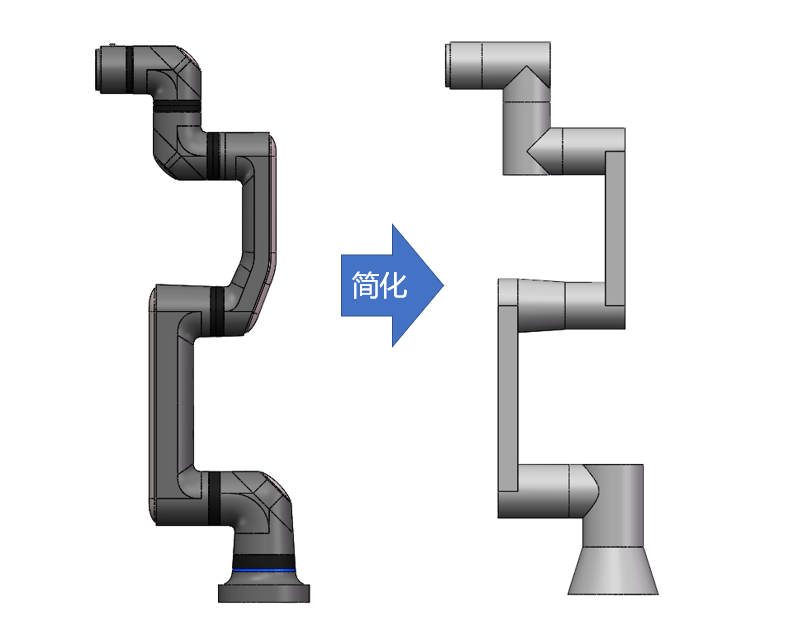

### 碰撞模型建立方法一：分别在各个连杆零件中单独建立DH坐标系

1、分别建立各连杆的简化模型，并在各连杆中对应位置建立DH参数坐标系；

2、对各连杆模型添加配合装配成整臂，各轴应处于0点位置，对照DH参数，检查坐标系正确性，即检查各个连杆中的坐标系间距是否与DH参数一致（如下图左）；

3、分别打开各连杆模型，另存为*.stl格式文件，在选项处设置“输出为二进制”、“单位为米”、“不要转换stl输出数据到正的坐标空间”、输出坐标系选择对应的坐标系，然后保存（如下图右），文件名分别为link0~link6.stl，注意文件名小写
***强调：一定要在输出坐标系下拉菜单中选择 新建立的DH坐标系，不要选择默认坐标系***         
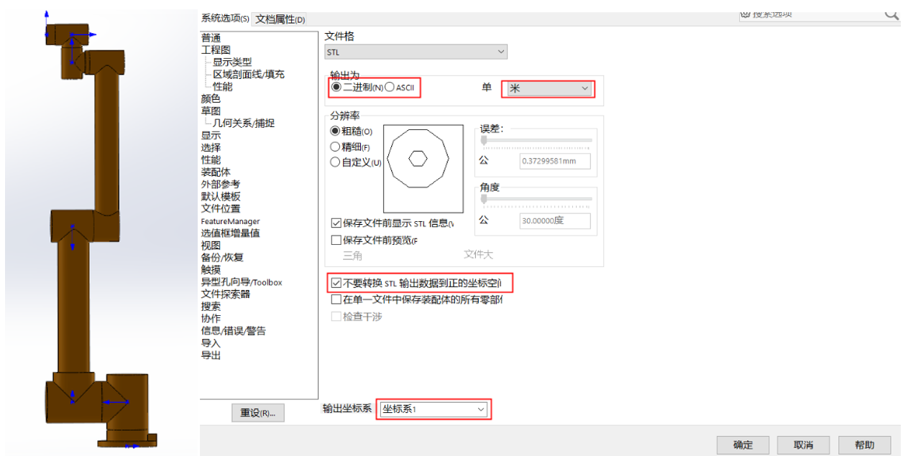

4、打开连杆.stl模型，检查模型原点是否与DH坐标系对应

### 碰撞模型建立方法二：直接在装配体中建立DH坐标系

1、分别建立各连杆的简化模型，并将其组装为简化模型装配体整臂，对轴应对应0点位置；

2、在装配体模型中建立DH参数坐标系，并对照DH参数表检查坐标系正确性，，即检查各个连杆中的坐标系间距是否与DH参数一致（如下图左），需要注意的是**装配体中建立的DH坐标系必须的参考只与对应连杆和总装基准有关，即link0对应的坐标系，不能以link1部件为参考建立（否则在进行第3步时，坐标系会被删除）**     
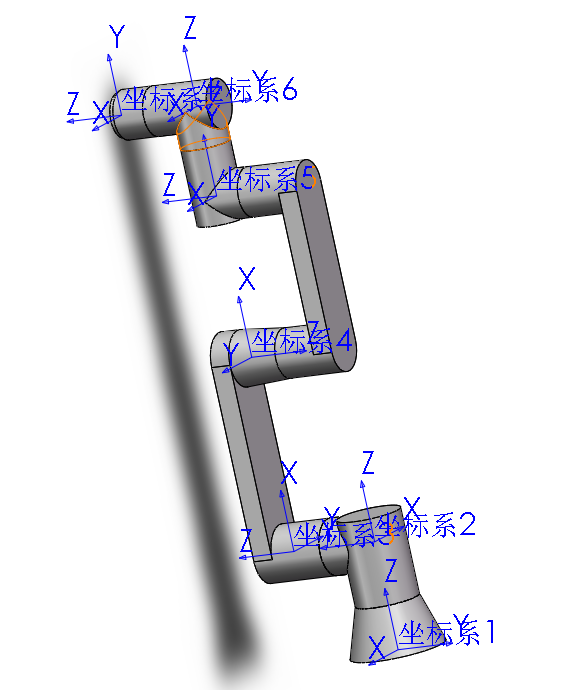

3、在装配体中将连杆link0~link6分别另存为*.stl格式文件：    
（1）在进行另存为*.stl文件之前需要在装配体中，把目标连杆之外的连杆模型压缩，保证激活的零件只有要导出的连杆（如下图1示意，导出link0.stl过程）    
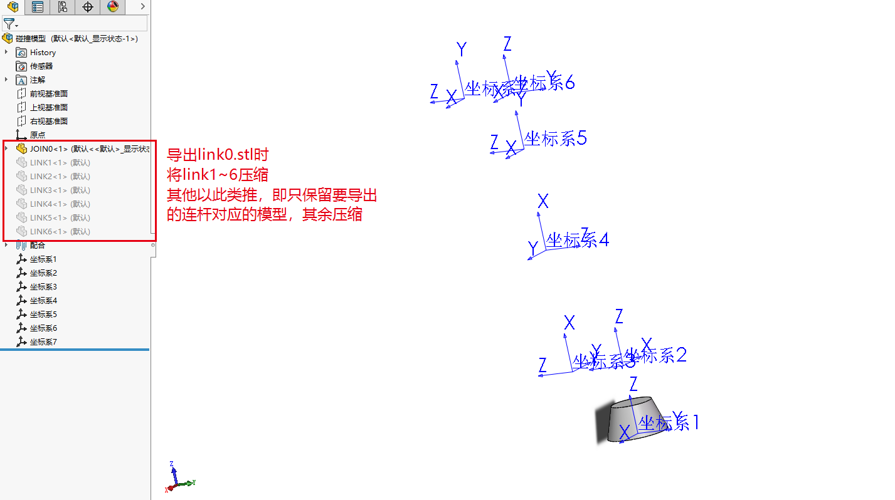         
（2）然后将装配体另存为*.stl格式文件，在选项处设置“输出为二进制”、“单位为米”、“不要转换stl输出数据到正的坐标空间”、输出坐标系选择对应的坐标系（注意link从0开始，坐标系从1开始，link0对应坐标系1，link1对应坐标系2，以此类推），然后保存（如下图右），文件名分别为link0~link6.stl，注意文件名小写 
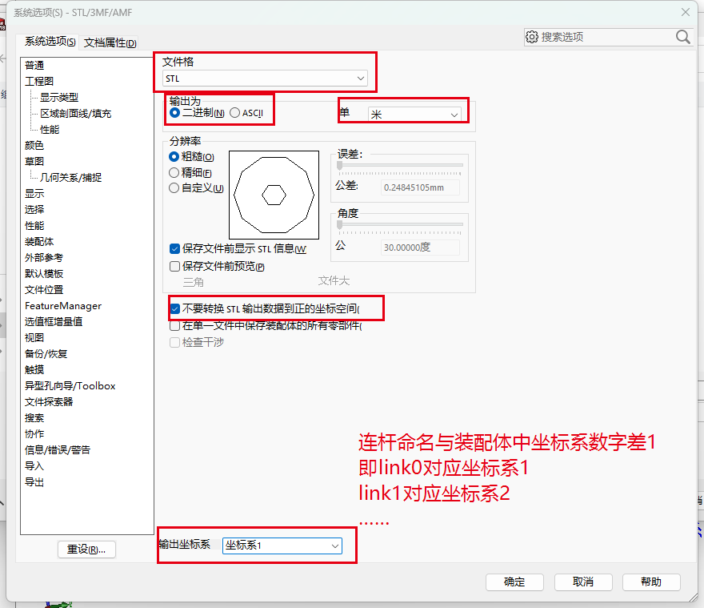         

4、打开连杆.stl模型，检查模型原点是否与DH坐标系对应    

----

**小结：**

（1）碰撞模型涉及solidworks转化为*.stl文件和对齐DH参数坐标系，一般不会出现问题
（2）只需要注意两种碰撞模型生成的操作过程中，对坐标系的选择
（3）一定***要选择自己建立的DH坐标系***，一定***不要选系统默认坐标系***

----

## 四、渲染模型输出

- 渲染模型用于ARCS示教软件中展示机械臂运动状态，即ARCS界面中看到的机械臂三维模型，可以显示机械臂的外观、型号、姿态以及实时运动
- 在ARCS架构下，渲染模型格式为“3ds”，需经过solidworks、3D Max和Meshlab三种软件通过三次转化而成
- DAE格式模型适用于ros中
- 渲染模型具有外观展示作用，需要将产品的机械设计三维模型转化为具备产品外观形态的简化实心模型，即保证外观展示作用前提下尽量简化模型

### 3ds显示模型生成方法

1、以机械臂本体机械结构模型为基础，使用solidworks建立各模块简化实心模型，将各模块、臂管等组装为link连杆装配体，再将连杆存为零件，在过程中需要将各零部件按照外观需求赋上对应颜色，如i系列橙黑，S系列银灰等；     

（1）需要确认所有模型没有薄壁结构（薄壁会导致颜色显示不全），如果存在薄壁结构，需要使用实心模型替换薄壁结构      
（2）为了减少软件计算工作量尽量将外观模型也简化，如底座模块的航插、各模块后盖的螺钉及图案，法兰面的螺钉及葫芦孔等，一般采用切除拉伸等特征即可，需要注意处理模型时***一定不能改变各连杆之间配合的面，否者会导致与实际设计的DH参数不符合***       
（3）另外为了保证后续可以保留产品外观效果，需要注意不同颜色的零件需要保持不同的实体（如关节机壳、胶圈和端盖虽然在一个连杆零件中，但需要为不同的实体）    
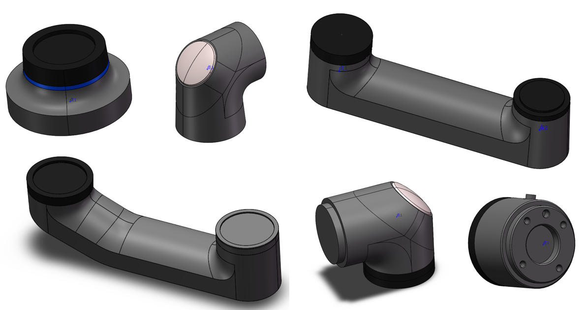         

2、对各连杆添加配合装配成整臂，需要注意将原点建立在底座模块的与地面连接的面的中心处，同时各轴应处于0点位置；
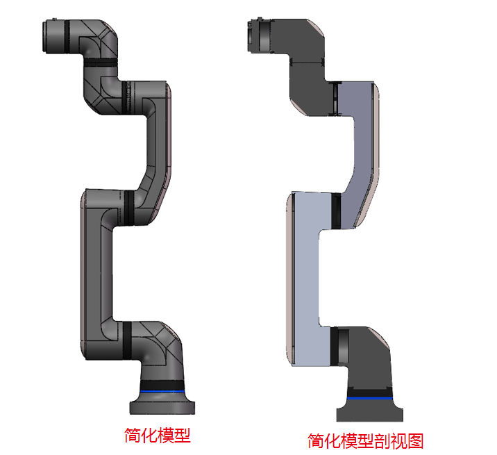         

3、添加各连杆的dh坐标系，注意每个坐标系的参考只与对应连杆和总装基准有关，即link0对应的坐标系，不能以link1部件为参考建立（否则在进行第5步时，坐标系会被删除）；
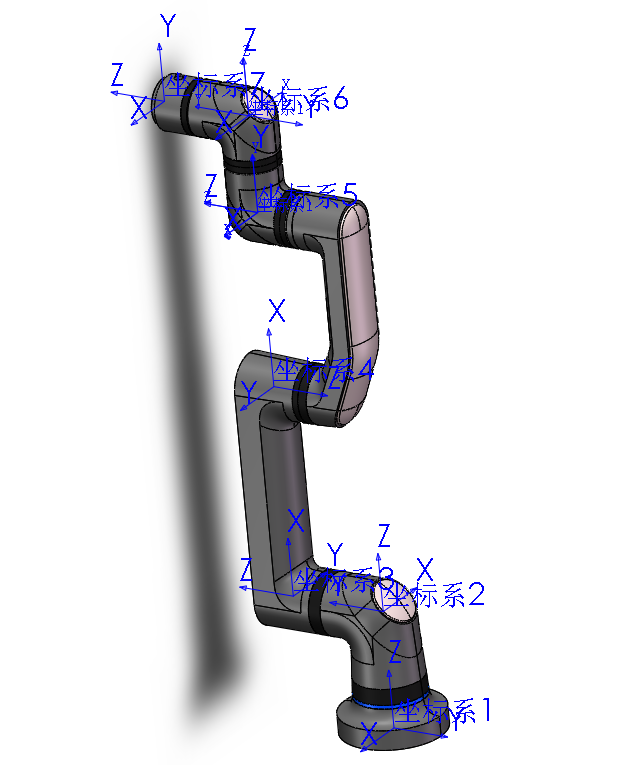         

4、对照DH参数，检查坐标系正确性；

5、将总装配体拷贝多份，和连杆数目一样，每个文件只保留一个连杆模型，带有对应的DH坐标系，将装配体另存**step214**格式（203导出后会丢失材质和颜色信息），点选项，选择输出对应坐标系（注意link从0开始，坐标系从1开始，link0对应坐标系1，link1对应坐标系2，以此类推），并保存到文件，注意文件名小写(本步骤亦可参考碰撞模型生成的两种存模型的方法，只需保证DH坐标系和对应的连杆对应好即可)     
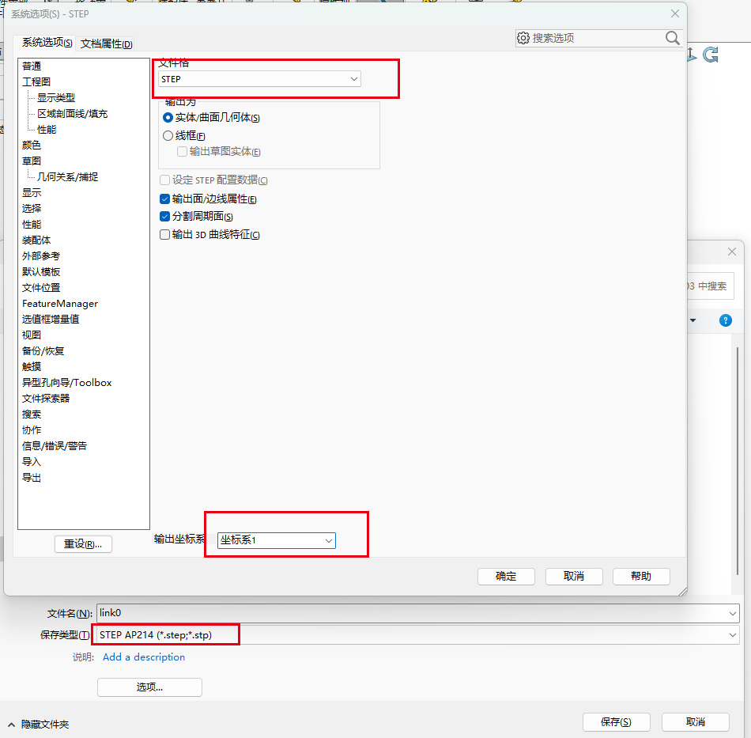 

**至此，得到由solidworks将简化外观模型转化成的step214文件，link0.step~link6.step。接下来需要通过3D Max软件将step文件转换为3ds文件**

6、打开3dmax软件对各用户路径和系统单位进行配置，参考下图示意

（1）用户路径配置：自定义->配置项目路径->更改scenes到工作空间（即你的模型文件存储的文件夹）     
（2）单位配置：自定义->单位设置->将系统单位设置和显示单位比例均改为mm（此处不改下一步导出的模型尺寸会错误）      
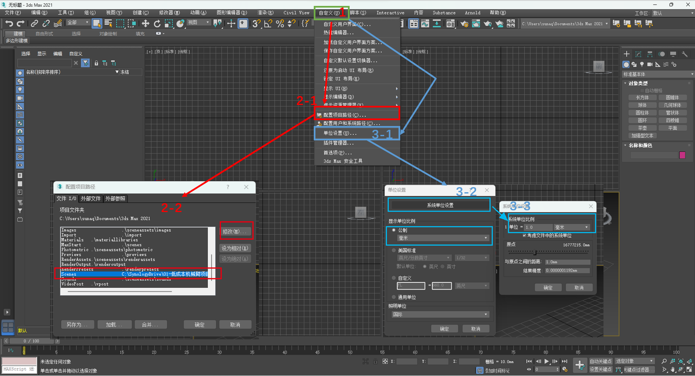 

7、在3D Max中新建项目，导入一个连杆的*.step文件，注意上方向轴选Z-向上（选错会导致坐标系错乱），下两图为导入步骤和S3_link0导入后的效果，注意检查坐标系方向、模型完整性和开零件颜色是否有问题（如有问题需要退回到solidworks建立模型和转step步骤中确认是否正确）；
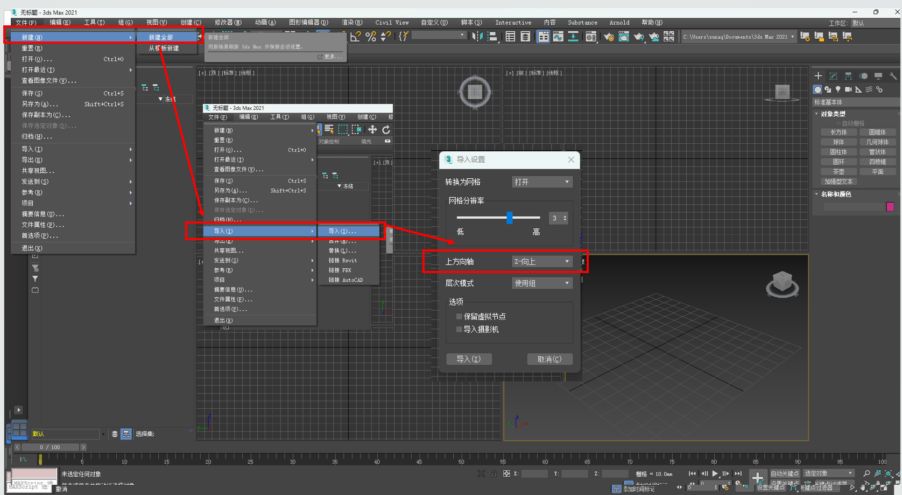 
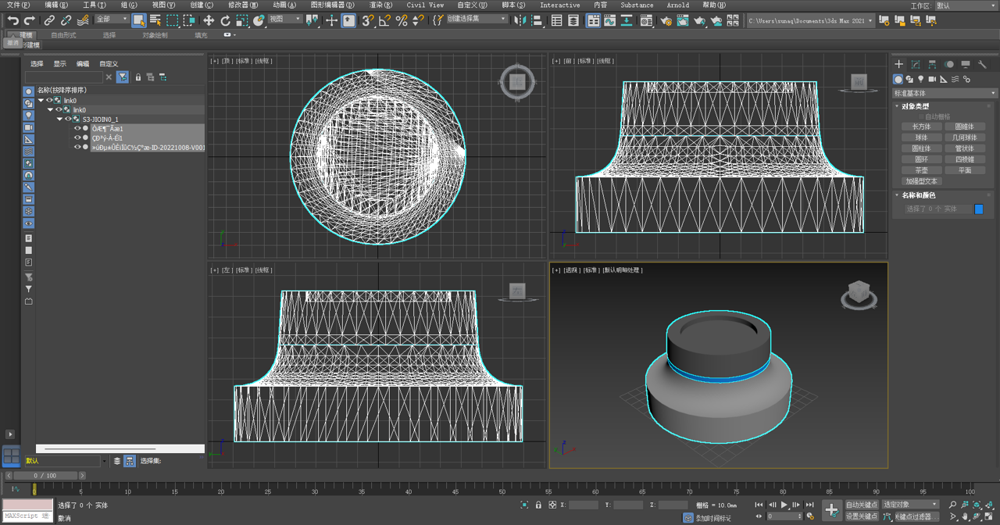 

8、导出*.3ds模型，选择“保持max的纹理坐标”，下图为导出步骤。
按照步骤7~8将link0~link6.step均转化为3ds文件；
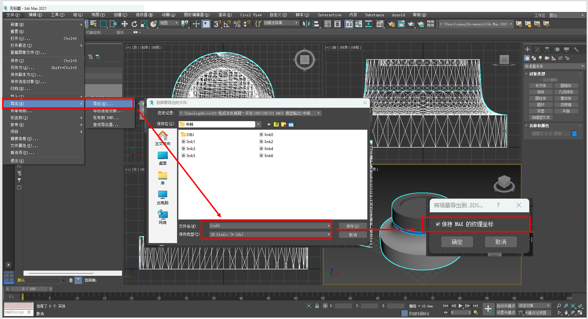 

**至此，实现了solidworks导出的step文件转化为3ds格式的步骤，link0.3ds~link6.3ds。接下来需要通过meshlab软件将3ds文件转换为可以导入ARCS环境的3ds文件（导入导出转存一遍）**

***注意，windows操作系统下的meshlab导出的3ds导入到ARCS环境下会丢失颜色，推断原因为跨系统文件转移会导致颜色文件丢失***      
***但windows系统下的meshlab可用于查看导出的3D Max软件导出的3ds文件是否有问题（常见的问题由跨软件转换过程中可能导致颜色丢失或者部分实体丢失）***    
***考虑机械工程师一般的办公电脑不具备Linux系统，故经过windows系统下的meshlab确认link0~link6文件均无问题后，可将文件发给算法部张世亮，在linux操作系统下的meshlab软件下另存一遍*.3ds文件***    

9、机械工程师在windows操作系统下，打开MeshLab软件，将3D Max生成的所有*.3ds文件导入后，检查各连杆模型实体、颜色和坐标系是否有问题，所有连杆均确认无问题后即完成渲染模型的转化工作   
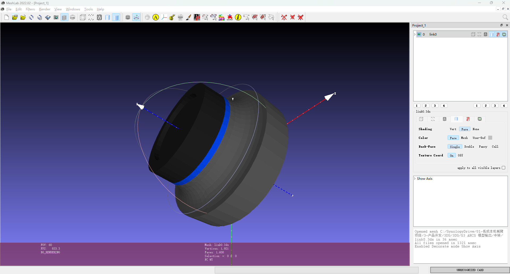 

**小结：**

（1）渲染模型涉及solidworks、3D Max和meshlab三种软件之间的文件转化，需要关注模型准确性、外观颜色准确性和DH坐标系准确性等，需要仔细处理才能避免出问题
（2）只需要注意step文件和3ds文件生成的操作过程中，对坐标系的选择
（3）一定***要选择自己建立的DH坐标系***，一定***不要选系统默认坐标系***

### DAE显示模型生成方法(适用于ros)

1、step文件生成方式与上步3ds生成方法中方式相同，可直接使用其step文件；

2、打开3dmax软件对用户路径和系统单位进行配置，注意，显示单位、系统单位配置为m，此处与3ds生成方式中单位设置不同不同，参考3ds生成的第6步；

3、在3D Max中新建项目，导入一个连杆的*.step文件，注意上方向轴选Z-向上（选错会导致坐标系错乱），参考3ds生成的第7步；

4、导出*.3ds模型，选择“保持max的纹理坐标”，下图为导出步骤

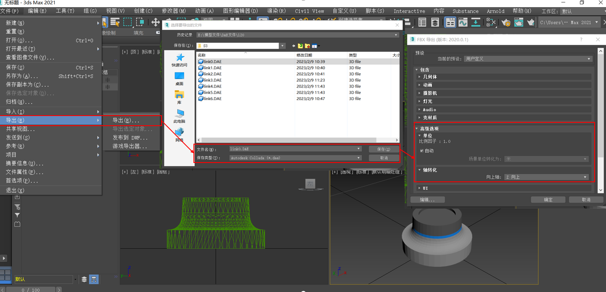

**注意**：

高级选项中场景单位转化是“米”；

轴转化中，向上轴选为z向上。

----

## 五、Linux下Meshlab转3ds，检查并提交碰撞和渲染模型到仓库

1、完成上述三和四步骤后，机械工程师将检查无误的link0.stl~link6.stl 和 link0.3ds~link6.3ds发送给算法部张世亮

2、张世亮将*.3ds文件在Linux系统下的meshlab中将3ds转存一遍，与机械工程师一起通过算法部仿真环境检查整臂模型是否满足要求

3、确认无误后，将碰撞模型stl和渲染3ds文件提交到git ARCS的aubo_description/meshes仓库下，产品对应型号的文件夹中。collision对应碰撞模型，visual对应渲染模型

以下为S3导入ARCS后界面效果     
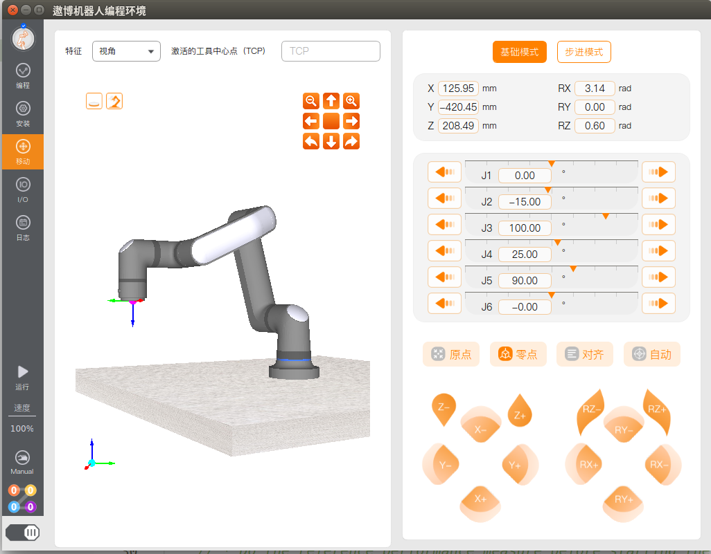 
