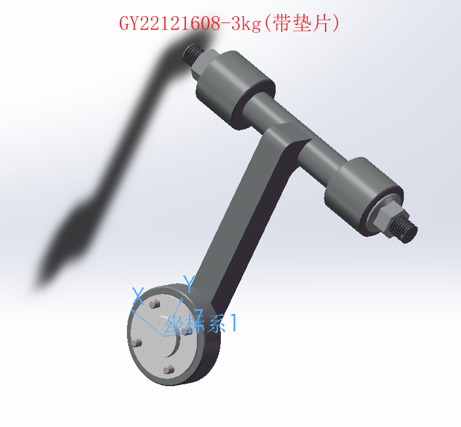
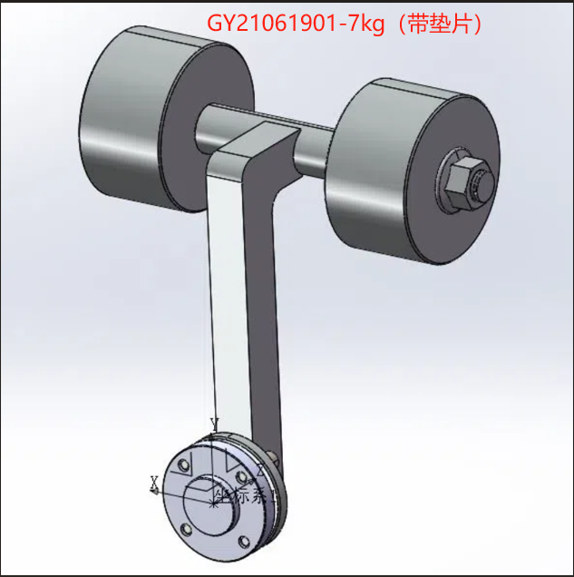
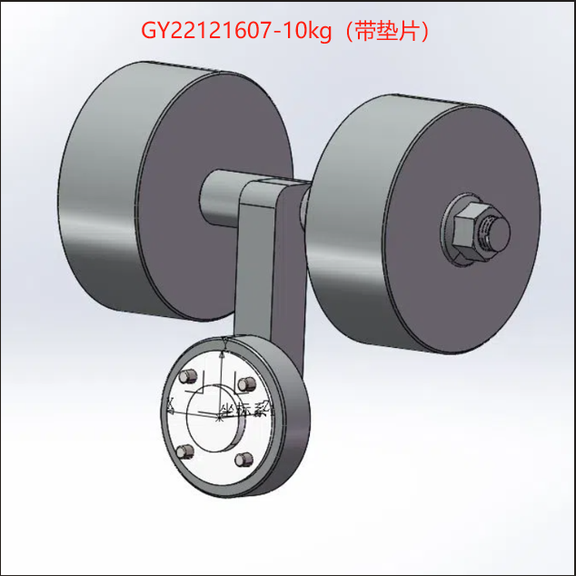
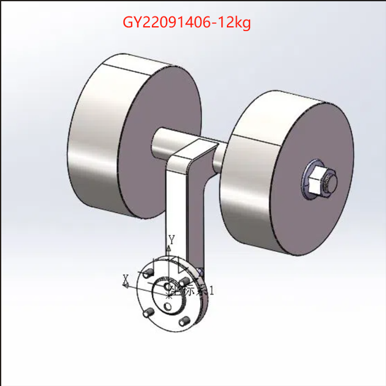
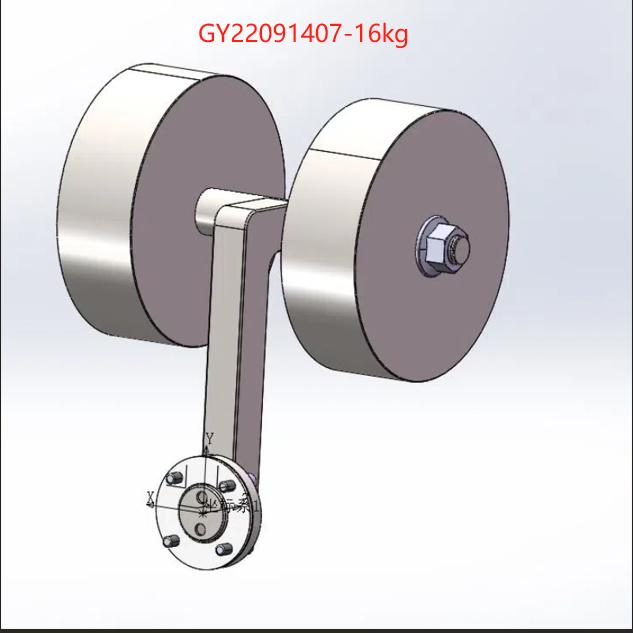
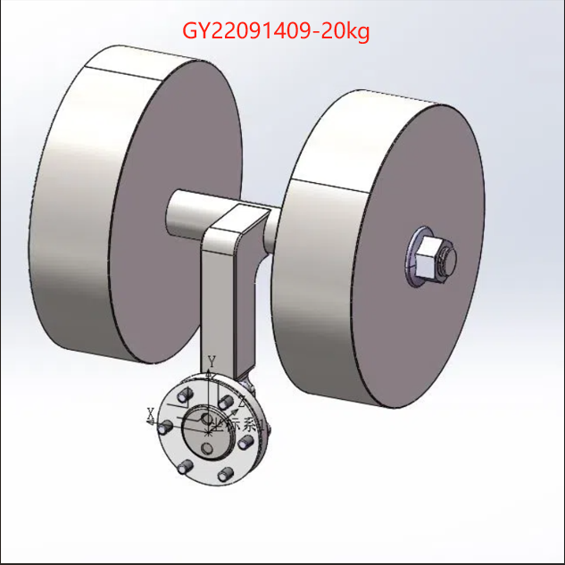

# 常用工具的质量、质心、惯量参数

1. 老化工装，表格中为其质量、质心、惯量值，其质心、惯量均为相对末端坐标系，单位采用国际标准单位制

   |          图号           |    m    |  x   |   y    |   z    |  Ixx   | Ixy  | Ixz  |  Iyy   |  Iyz   |  Izz   |
   | :---------------------: | :-----: | :--: | :----: | :----: | :----: | :--: | :--: | :----: | :----: | :----: |
   | GY22121608-3KG(带垫片)  | 3.0372  |  0   | 0.1058 | 0.0405 | 0.0078 |  0   |  0   | 0.0018 | 0.0023 | 0.0079 |
   | GY22121606-5KG((带垫片) |  4.876  |  0   | 0.129  | 0.047  | 0.0157 |  0   |  0   | 0.0042 | 0.0047 | 0.0163 |
   | GY21061901-7kg(带垫片)  | 6.5707  |  0   | 0.1506 | 0.061  | 0.1946 |  0   |  0   | 0.0593 | 0.0655 | 0.1953 |
   | GY22121607-10kg(带垫片) | 9.7803  |  0   | 0.0866 | 0.0496 | 0.1193 |  0   |  0   | 0.0803 | 0.0444 | 0.1354 |
   |     GY22091406-12kg     | 11.9179 |  0   | 0.0987 | 0.0614 | 0.1907 |  0   |  0   | 0.1206 | 0.0752 | 0.1955 |
   |     GY22091407-16kg     | 15.9661 |  0   | 0.149  | 0.0618 | 0.4729 |  0   |  0   | 0.1687 | 0.1519 | 0.4741 |
   |     GY22091409-20kg     | 19.6185 |  0   | 0.098  | 0.0601 | 0.3333 |  0   |  0   | 0.2139 | 0.1181 | 0.3352 |

   |  |  |  |  |
   | ------------------------------------------------------------ | ------------------------------------------------------------ | ------------------------------------------------------------ | ------------------------------------------------------------ |
   | GY22121608-3KG                               | GY22121606-5KG                               | GY21061901-7kg                                | GY22121607-10kg                               |
   |  |  |  |  |
   | GY22091406-12kg | GY22091407-16kg | GY22091409-20kg |  |

2. 重复定位工装，表格中为其质量、质心、惯量值，其质心、惯量均为相对末端坐标系，单位采用国际标准单位制

|    图号    |    m    |  x   |   y    |   z    |  Ixx   | Ixy  | Ixz  |  Iyy   |  Iyz   |  Izz   |
| :--------: | :-----: | :--: | :----: | :----: | :----: | :--: | :--: | :----: | :----: | :----: |
| GY21072101 | 15.8281 |  0   | 0.0798 | 0.1193 | 0.3979 |  0   |  0   | 0.2572 | 0.1572 | 0.1645 |
| GY21072001 | 9.9746  |  0   | 0.0989 | 0.1095 | 0.256  |  0   |  0   | 0.1395 | 0.1175 | 0.1307 |
| GY21070301 | 4.8521  |  0   |   0    |  0.13  | 0.1039 |  0   |  0   | 0.1039 |   0    | 0.0022 |
| GY21071001 | 2.9439  |  0   |   0    | 0.1435 | 0.0778 |  0   |  0   | 0.0778 |   0    | 0.0011 |

| .png) | .png) | .png) | .png) |
| ------------------------------ | ------------------------------ | ----------------------------- | ----------------------------- |
| GY21072101(16kg)               | GY21072001(10kg)               | GY21070301(5kg)               | GY21071001(3kg)               |

